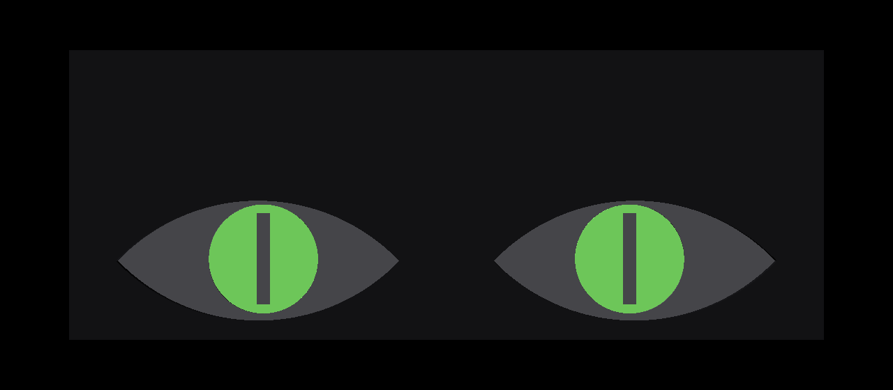
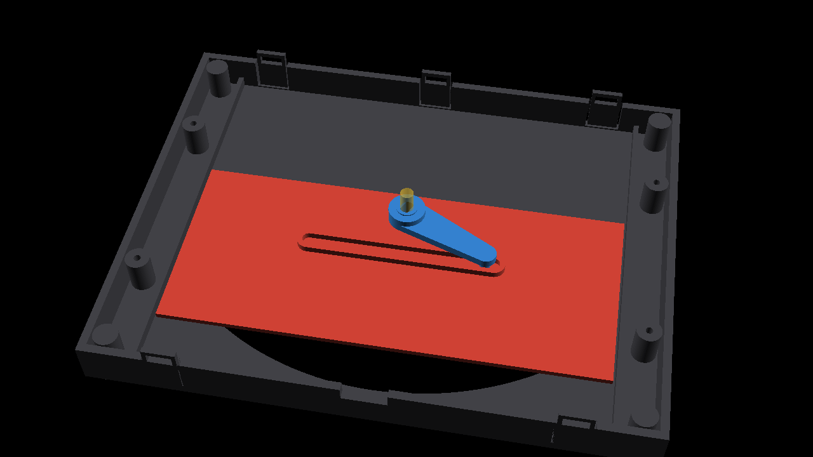

# Halloween eyes

A pair of slowly blinking eyes for a front window. Each eye is a 3D-printed module with a sliding
eyelid driven by a 28BYJ-48 stepper through a scotch-yoke crank. The eyes swell into view, blink,
then close and fade to dark. A glow-in-the-dark iris (strontium aluminate charged by hidden 365 nm
UV LEDs) is the planned second pass; for now a PWM LED stands in for it.





See `eyes_preview.mp4` for an animated assembly and the full routine.

## Layout

- `cad/eye.scad` — parametric OpenSCAD model (one eye module; two butt together for a 400 x 154 mm face)
- `cad/anim.scad`, `cad/render_video.py` — renders `eyes_preview.mp4` (needs OpenSCAD + ffmpeg)
- `stl/` — print-ready parts
- `firmware/eyes/eyes.ino` — builds for the ESP32-S3 Super Mini and the Arduino Uno R4 WiFi test rig

## Printing (PETG)

Per eye: `eye_front` (face down), `eye_back` (as exported), `eye_lid` (flat face down), `eye_crank`.
One `splice` joins the two eyes and holds the electronics. `motor_fit_test` and `snap_test` are quick
checks. Hardware: 2x M3x6 per motor (thread into the plastic), 4x M3x20 for the splice plate.

## Wiring

| | Uno R4 WiFi | ESP32-S3 Super Mini |
|---|---|---|
| Left eye ULN2003 IN1-IN4 | D8-D11 | GPIO 1-4 |
| Right eye ULN2003 IN1-IN4 | D4-D7 | GPIO 5-8 |
| Glow LED / UV driver (PWM) | D3 | GPIO 9 |

Both ULN2003 boards take 5 V and GND.

## Firmware

```
arduino-cli compile --upload --fqbn arduino:renesas_uno:unor4wifi -p <port> firmware/eyes
arduino-cli compile --upload --fqbn esp32:esp32:esp32s3:CDCOnBoot=cdc -p <port> firmware/eyes
```

Serial at 115200: `a`/`d` jog the crank, `z` sets the current position as closed, `o` open,
`c` close, `b` blink, `p` full routine, `g` toggle the glow LED. There is no home switch: on power-up
the lids are assumed closed.

## License

MIT, see [LICENSE](LICENSE). Covers the CAD files, STLs and firmware.
